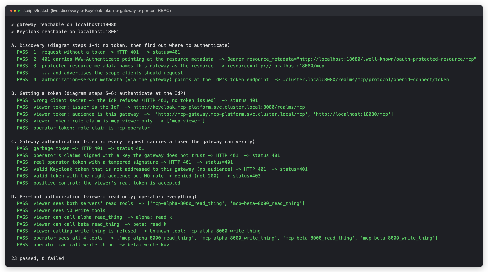

# MCP gateway on GKE

An AI agent should not call every MCP server directly. This repo puts **one gateway** in front of them: the agent
authenticates against an **identity provider (Keycloak)**, gets a **JWT**, and sends it to the gateway; the gateway
verifies it, decides which *tools* that caller may see or call, and forwards to the right MCP server. Runs on GKE
Autopilot with [agentgateway](https://agentgateway.dev) 1.6 (Gateway API, MCP spec 2026-07-28).

> **Status: milestone 2 of 4.** The identity flow and the gateway policy are real and tested end to end; the three
> real MCP servers and the AI agent are next. See [Roadmap](#roadmap). Every output below is captured from a real run.


**New to MCP gateways? Start with [docs/how-mcp-works.md](docs/how-mcp-works.md)**
(components, request flow, OAuth/JWT, one vs many gateways, best practices).

## What works today (23 live checks, `./scripts/test.sh`)

| Claim | Checks |
|---|---|
| **Discovery**: a request with no token gets 401 + `WWW-Authenticate: resource_metadata=<url>`; the gateway serves protected-resource and authorization-server metadata | 5 |
| **Token issuance**: Keycloak issues a JWT (client-credentials) with the right issuer, audience = this gateway and a role; a wrong client secret gets no token | 5 |
| **Gateway authentication**: garbage token, token signed by an untrusted key, tampered signature, valid token *not addressed to this gateway*: all 401. Valid audience but no role: 403. The viewer's real token: accepted | 6 |
| **Per-tool authorization**: a `viewer` sees and calls only read tools (write tools hidden, direct call refused); an `operator` sees and calls everything | 7 |



Trying it by hand, what is running, and the gateway's access log:


## Run it

```bash
gcloud config set project <your-project>     # billing linked
./scripts/up.sh      # ~12 min from nothing: Autopilot, agentgateway, Keycloak, servers, policies
./scripts/test.sh    # 23 live checks; non-zero exit if any fail
./scripts/pf.sh      # (optional) keep port-forwards open, then use tests/cli.py by hand
./scripts/down.sh    # delete everything and prove nothing billable is left
```
Hands-on commands and troubleshooting: [docs/runbook.md](docs/runbook.md). Design notes: [docs/architecture.md](docs/architecture.md).

**Cost:** the GKE free-tier credit covers the management fee for one Autopilot cluster; you pay for requested pod
CPU/memory (about 6 small pods, Keycloak is the largest) and one load balancer. Leave it up for hours, not weeks.

## Layout

```
terraform/     Autopilot cluster (state in the project's tfstate bucket)
deploy/chart/  Helm chart: Keycloak + realm-as-code, MCP servers, Gateway/HTTPRoute/Backend, policies
tests/         test_flow.py (the 23 checks), cli.py (poke it by hand), common.py
scripts/       up.sh · test.sh · pf.sh · down.sh · lib.sh
docs/          how-mcp-works, architecture, runbook, diagram generator, captured evidence
spike/         findings from the first proof-of-concept
```

## Roadmap

| Milestone | Status |
|---|---|
| 1. Gateway on Autopilot, federation, JWT, per-tool RBAC | done |
| 2. **Keycloak IdP + MCP discovery flow + role check, tested end to end** | **done** |
| 3. Three real servers (k8s read-only ops, BigQuery FinOps, Firestore tickets); Workload Identity per server; gateway-to-server service-to-service auth; NetworkPolicy default-deny | next |
| 4. AI agent (ADK + Gemini on Vertex) doing the full flow; audit log, tracing, rate limits; TLS | planned |

## Known gaps (deliberate for now)

* **The gateway's Service is a public `LoadBalancer` on plain HTTP.** Every request needs a valid JWT, but there is no TLS. Milestone 4.
* **Keycloak runs in dev mode with an in-memory database.** Restarting it generates new signing keys and loses the realm
  until it is re-imported. The gateway caches Keycloak's keys (minimum 5 min), so after a Keycloak-only restart tokens fail
  with 401 `unknown key` until the policy is re-applied (see the runbook). Production: persistent database, key rotation policy.
* **Machine clients only.** Service clients use the client-credentials grant. Human login (authorization code + PKCE) and
  dynamic client registration (deprecated in the July 2026 MCP revision in favour of Client ID Metadata Documents) are not exercised.
* The gateway currently forwards to servers with no credential and the toy servers do not check one: milestone 3.
* The toy servers install dependencies from PyPI at start-up; the real build uses images from Artifact Registry.
* The cluster API is reachable from your public IP only (`authorized_cidr`); if your IP changes, re-run `up.sh`.
